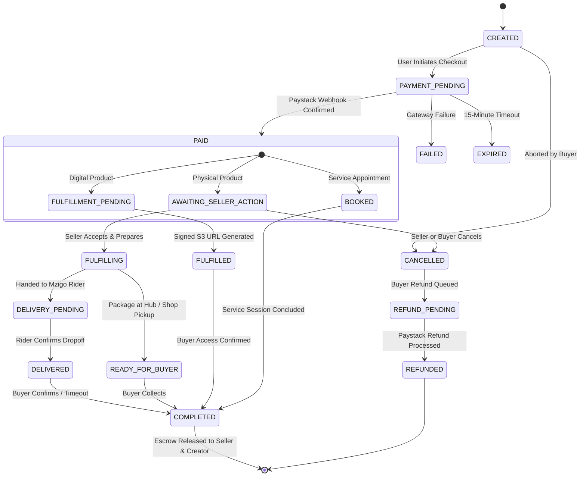

# BYBLOS — ACTION PURPOSE, BUSINESS LOGIC, AND IMPLEMENTATION TRACE
**Phase 2 Deliverable: Action-to-Code-to-Database Trace & Financial Invariants**
**Date:** 2026-11-14  
**Project:** Byblos E-Commerce Ecosystem  
**Target Architecture:** Domain-Driven Design (DDD) with Strict PostgreSQL Foreign Keys & Escrow Guardrails

---

## 1. Core Financial & Escrow Invariants

The Byblos monetary engine operates under an **Escrow-First Ledger** model governed by [`EscrowManager.js`](file:///c:/Users/Administrator/Downloads/evolve/evolve%20projects/byblos/code/bybloshq/server/src/domains/orders/escrow/EscrowManager.js), [`settlement.service.js`](file:///c:/Users/Administrator/Downloads/evolve/evolve%20projects/byblos/code/bybloshq/server/src/domains/orders/escrow/settlement.service.js), and [`productCheckout.service.js`](file:///c:/Users/Administrator/Downloads/evolve/evolve%20projects/byblos/code/bybloshq/server/src/domains/payments/payments/productCheckout.service.js):

### 1.1 Ownership of Funds
1. **At Payment Initiation:** When a buyer initiates Paystack checkout, an order is inserted with status `PAYMENT_PENDING` and inventory is reserved with a 15-minute lock.
2. **At Payment Confirmation:** When the Paystack HMAC webhook fires (`charge.success`), funds belong to the **Byblos Escrow Holding Pool**. The order status becomes `PAID`. Neither the seller nor any referring creator can withdraw or spend these funds.
3. **At Order Delivery/Completion:** When the buyer confirms receipt (or when a digital product is fulfilled, or upon auto-completion deadline), the escrow is unlocked via `EscrowManager.releaseFunds()`.
   - The platform fee is deducted and credited to `platform_revenue`.
   - The net merchant payout is deposited into the merchant's `pending_settlement_balance`.
   - If attributed to an affiliate creator, the commission is credited to the creator's `pending_balance`.
4. **Settlement Maturation (T+2 Business Days):** Funds remain in `pending_settlement_balance` for 2 business days (`settlementCron.js`) to protect against immediate chargebacks before shifting into `available_balance`.
5. **Withdrawal Execution:** When a seller or creator submits a withdrawal request:
   - The requested amount + fee is moved from `available_balance` to `reserved_balance`.
   - When the Paystack Transfer webhook confirms success, `reserved_balance` is permanently debited.
   - If the transfer fails or is rejected, the funds are automatically refunded back to `available_balance`.

---

## 2. Order State Machine Rules

The state transitions are enforced by [`OrderStatusGuard.js`](file:///c:/Users/Administrator/Downloads/evolve/evolve%20projects/byblos/code/bybloshq/server/src/domains/orders/utils/OrderStatusGuard.js):

### 2.1 Transition Invariants
- **Terminal States:** `COMPLETED`, `CANCELLED`, and `REFUNDED` are strictly terminal. No transition out of these states is permitted.
- **Double Credit Prevention:** `EscrowManager.releaseFunds()` checks an atomic transaction lock (`SELECT * FROM orders WHERE id = $1 FOR UPDATE`) and checks `escrow_released_at IS NULL`. It can never release funds twice.
- **Self-Dealing Guard:** In affiliate sales, if the creator ID matches the buyer user ID or the seller user ID, creator commission is rejected (`is_self_dealing = true`) and platform retains 0% commission payout.

---

## 3. End-to-End Implementation Trace by Role

### 3.1 Buyer Actions Trace

#### Action 1: Register Account
- **Frontend Entry:** [`src/features/buyer/pages/BuyerRegister.tsx`](file:///c:/Users/Administrator/Downloads/evolve/evolve%20projects/byblos/code/bybloshq/src/features/buyer/pages/BuyerRegister.tsx)
- **API Endpoint:** `POST /api/buyers/register`
- **Controller:** `buyerController.register` in [`server/src/domains/identity/auth/buyerAuth.controller.js`](file:///c:/Users/Administrator/Downloads/evolve/evolve%20projects/byblos/code/bybloshq/server/src/domains/identity/auth/buyerAuth.controller.js)
- **Service Logic:** `authService.registerBuyer` -> hashes password via `bcrypt`, generates random 64-char verification token.
- **Database Effects:** `INSERT INTO users (email, password_hash, role='buyer', is_verified=false)`, `INSERT INTO buyers (user_id, name, phone)`.
- **Notifications:** Dispatches verification email via `emailService.sendVerificationEmail`.
- **Validation Rules:** Zod schema validates email syntax, phone E.164 formatting, minimum 8 characters with number and special character.

#### Action 2: Product Discovery & Checkout Initiation
- **Frontend Entry:** [`src/features/shop/pages/ShopPage.tsx`](file:///c:/Users/Administrator/Downloads/evolve/evolve%20projects/byblos/code/bybloshq/src/features/shop/pages/ShopPage.tsx) -> [`BagSheet.tsx`](file:///c:/Users/Administrator/Downloads/evolve/evolve%20projects/byblos/code/bybloshq/src/features/shop/components/BagSheet.tsx)
- **API Endpoint:** `POST /api/payments/initiate-product`
- **Controller:** `paymentController.initiateProductPayment` in [`server/src/domains/payments/payments/payment.controller.js`](file:///c:/Users/Administrator/Downloads/evolve/evolve%20projects/byblos/code/bybloshq/server/src/domains/payments/payments/payment.controller.js)
- **Service Logic:** `productCheckoutService.initiateProductPayment`
  1. Validates prices against database `products.price` (ignores client-supplied amounts to prevent price tampering).
  2. Acquires row lock `SELECT inventory FROM products WHERE id = $1 FOR UPDATE`.
  3. Validates available stock >= requested quantity.
  4. Deducts temporary inventory lock or registers reservation.
  5. Calls Paystack API `initializeTransaction` with callback URL.
- **Database Effects:** `INSERT INTO orders (status='PAYMENT_PENDING', subtotal, delivery_fee, total_amount)`, `INSERT INTO order_items`.
- **Financial Effects:** No money moves yet; invoice generated in Paystack sandbox.

#### Action 3: Confirm Physical Order Receipt
- **Frontend Entry:** [`src/features/buyer/pages/BuyerDashboard.tsx`](file:///c:/Users/Administrator/Downloads/evolve/evolve%20projects/byblos/code/bybloshq/src/features/buyer/pages/BuyerDashboard.tsx) (Orders Tab)
- **API Endpoint:** `PATCH /api/orders/:id/confirm-receipt`
- **Controller:** `orderController.confirmReceipt` in [`server/src/domains/orders/order/order.controller.js`](file:///c:/Users/Administrator/Downloads/evolve/evolve%20projects/byblos/code/bybloshq/server/src/domains/orders/order/order.controller.js)
- **Service Logic:** `OrderService.confirmReceipt` -> verifies `req.user.id == order.buyer_id` -> updates status to `COMPLETED` -> calls `escrowManager.releaseFunds()`.
- **Database Effects:** `UPDATE orders SET status='COMPLETED', completed_at=NOW()`, `UPDATE sellers SET pending_settlement_balance = pending_settlement_balance + net_amount`.
- **Financial Effects:** Escrow pool debited, seller pending settlement credited.

---

### 3.2 Seller Actions Trace

#### Action 1: Onboard Store & Create Shop
- **Frontend Entry:** [`src/features/seller/pages/SellerRegistration.tsx`](file:///c:/Users/Administrator/Downloads/evolve/evolve%20projects/byblos/code/bybloshq/src/features/seller/pages/SellerRegistration.tsx)
- **API Endpoint:** `POST /api/sellers/register`
- **Controller:** `sellerController.register` in [`server/src/domains/commerce/sellers/seller.controller.js`](file:///c:/Users/Administrator/Downloads/evolve/evolve%20projects/byblos/code/bybloshq/server/src/domains/commerce/sellers/seller.controller.js)
- **Service Logic:** Checks shop name uniqueness against `sellers.shop_name` (slugified). Creates user and seller record.
- **Database Effects:** `INSERT INTO users (role='seller')`, `INSERT INTO sellers (shop_name, slug, balance=0, status='active')`.
- **Notifications:** Verification email sent.

#### Action 2: Add Product to Catalog (Physical, Digital, Service)
- **Frontend Entry:** [`src/features/seller/components/dashboard/tabs/ProductsTab.tsx`](file:///c:/Users/Administrator/Downloads/evolve/evolve%20projects/byblos/code/bybloshq/src/features/seller/components/dashboard/tabs/ProductsTab.tsx)
- **API Endpoint:** `POST /api/sellers/products` (or `/products/upload-digital`)
- **Controller:** `productController.createProduct`
- **Service Logic:** Enforces minimum price (KES 50), validates inventory count, uploads image attachments. For digital items, streams binary file to private storage bucket.
- **Database Effects:** `INSERT INTO products (seller_id, title, price, inventory, product_type, digital_file_url)`.

#### Action 3: Request Payout Withdrawal
- **Frontend Entry:** [`src/features/seller/components/dashboard/tabs/WithdrawalsTab.tsx`](file:///c:/Users/Administrator/Downloads/evolve/evolve%20projects/byblos/code/bybloshq/src/features/seller/components/dashboard/tabs/WithdrawalsTab.tsx)
- **API Endpoint:** `POST /api/sellers/withdrawal-request`
- **Controller:** `withdrawalController.createWithdrawal` in [`server/src/domains/payments/payouts/withdrawal.controller.js`](file:///c:/Users/Administrator/Downloads/evolve/evolve%20projects/byblos/code/bybloshq/server/src/domains/payments/payouts/withdrawal.controller.js)
- **Service Logic:** Checks `available_balance >= amount + fee`. Atomically moves `amount + fee` from `available_balance` into `reserved_balance`.
- **Database Effects:** `INSERT INTO withdrawal_requests (seller_id, amount, fee, status='PENDING')`, `UPDATE sellers SET available_balance = available_balance - total, reserved_balance = reserved_balance + total`.
- **Financial Effects:** Funds locked from seller spending until admin approval and transfer execution.

---

### 3.3 Creator Actions Trace

#### Action 1: Referral Link Generation & Attribution Cookie
- **Frontend Entry:** [`src/features/creator/pages/CreatorDashboard.tsx`](file:///c:/Users/Administrator/Downloads/evolve/evolve%20projects/byblos/code/bybloshq/src/features/creator/pages/CreatorDashboard.tsx)
- **API Endpoint:** `POST /api/creators/referral/generate-code`
- **Public Entry Point:** `POST /api/creators/links/:code/click`
- **Controller:** `creatorController.trackLinkClick`
- **Service Logic:** Validates affiliate code, records click event with user-agent and IP hash, returns attribution metadata which frontend sets in `byblos_ref` cookie (30-day sliding TTL).
- **Database Effects:** `INSERT INTO creator_link_clicks (creator_id, code, ip_hash)`.

#### Action 2: Commission Calculation on Completed Purchase
- **Trigger:** Webhook / Order Completion (`orderFulfillmentTransition.service.js` or `OrderService.js`)
- **Service Logic:** `creatorService.creditCreatorForOrder`
  1. Inspects `order.referral_code` or `order.creator_id`.
  2. Runs self-dealing check (creator != buyer && creator != seller).
  3. Fetches active collaboration commission rate (e.g. 5% to 15%).
  4. Calculates commission in integer cents (`toCents(order.subtotal * rate)`).
  5. Credits `creator.pending_balance` with T+2 business day settlement.
- **Database Effects:** `INSERT INTO creator_earnings (creator_id, order_id, amount, status='pending')`, `UPDATE creators SET pending_balance = pending_balance + amount`.

---

### 3.4 Mzigo Ego (Logistics) Actions Trace

#### Action 1: Accept Pickup Assignment
- **Frontend Entry:** [`src/features/logistics/pages/MzigoDashboard.tsx`](file:///c:/Users/Administrator/Downloads/evolve/evolve%20projects/byblos/code/bybloshq/src/features/logistics/pages/MzigoDashboard.tsx)
- **API Endpoint:** `PATCH /api/logistics/requests/:requestId/legs/:legType/status`
- **Controller:** `logisticsController.updateLogisticsLegStatus` in [`server/src/domains/logistics/logistics.controller.js`](file:///c:/Users/Administrator/Downloads/evolve/evolve%20projects/byblos/code/bybloshq/server/src/domains/logistics/logistics.controller.js)
- **Service Logic:** Verifies authenticated rider belongs to approved logistics partner. Updates leg status from `PENDING` to `ASSIGNED`.
- **Database Effects:** `UPDATE delivery_legs SET rider_id = $1, status = 'ASSIGNED', assigned_at = NOW()`.
- **Notifications:** Emits `logistics:leg_updated` event; seller alerted to prepare package for collection.

#### Action 2: Confirm Package Collection & Delivery Dropoff
- **API Endpoint:** `PATCH /api/logistics/requests/:requestId/legs/:legType/status` with `status: 'DELIVERED'`
- **Service Logic:** Requires buyer dropoff verification PIN. Validates leg sequence (pickup must precede delivery). Sets order to `DELIVERY_COMPLETE` / `READY_FOR_BUYER`.
- **Database Effects:** `UPDATE delivery_legs SET status='DELIVERED', completed_at=NOW()`, `UPDATE orders SET status='DELIVERY_COMPLETE'`.

---

### 3.5 Admin Actions Trace

#### Action 1: Process Withdrawal Payout
- **Frontend Entry:** [`src/features/admin/pages/AdminDashboard.tsx`](file:///c:/Users/Administrator/Downloads/evolve/evolve%20projects/byblos/code/bybloshq/src/features/admin/pages/AdminDashboard.tsx)
- **API Endpoint:** `PATCH /api/admin/withdrawal-requests/:id/status`
- **Controller:** `adminController.updateWithdrawalRequestStatus`
- **Service Logic:** If status set to `PAID`:
  1. Initiates Paystack Transfer API call.
  2. Deducts `reserved_balance` on recipient wallet.
  3. Records transfer reference and fee breakdown.
- **Database Effects:** `UPDATE withdrawal_requests SET status='PAID', transfer_reference=...`, `UPDATE sellers/creators SET reserved_balance = reserved_balance - amount`.

#### Action 2: Dead-Letter Fulfillment Job Recovery
- **Frontend Entry:** Admin Dashboard Fulfillment Tab
- **API Endpoint:** `POST /api/admin/fulfillment/jobs/:id/retry`
- **Controller:** `adminController.retryFulfillmentJob`
- **Service Logic:** Fetches failed event from `dead_letter_jobs`, validates order state, re-queues job to background worker queue.
- **Database Effects:** `UPDATE dead_letter_jobs SET status='RETRIED', retried_at=NOW()`.

---
**Status:** Complete Action Purpose and Business Logic Trace documented. Proceeding immediately to Phase 3: Test Environment and Data Setup.

