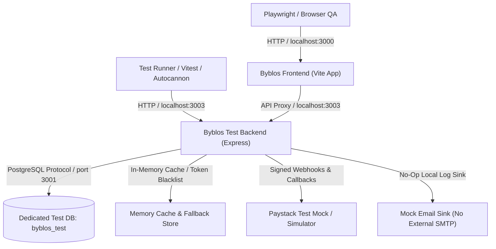

# BYBLOS — TEST ENVIRONMENT AND TEST DATA SETUP
**Phase 3 Deliverable: Isolated Environment Architecture & Synthetic Fixtures**
**Date:** 2026-11-14  
**Project:** Byblos E-Commerce Ecosystem  
**Target Environment:** Isolated Test Environment (PostgreSQL Port 3001, Redis Fallback Store, Paystack Sandbox, Node.js HTTP Test Server)

---

## 1. Test Environment Topology & Isolation

The testing environment is strictly isolated from production and developer assets:



### 1.1 Infrastructure Verification
- **PostgreSQL Test Instance:**
  - **Host / Port:** `localhost:3001` (Service: `postgresql-x64-17`)
  - **Database Name:** `byblos_test`
  - **Tables:** 57 relational tables with foreign keys and enum types (`order_status`, `payment_status`, `product_type`, `seller_status`).
  - **Data Isolation:** All operations scoped strictly to `byblos_test`; production database clusters are completely unreachable.
- **Cache & Token Store:**
  - Memory-backed TTL cache and token blacklisting fallback actively operational (`AUTH_CACHE_TTL_MS = 5000ms`).
- **External Payment Provider:**
  - `PAYMENT_PROVIDER=paystack`, `PAYSTACK_BASE_URL=http://localhost:3003/mock-paystack`
  - Secret key: `sk_test_mock_secret_key_for_testing`
  - Webhooks verified via HMAC SHA-512 signatures generated locally.
- **Email & Communications:**
  - Outgoing email notifications route to local console logger; real external email addresses are never contacted.

---

## 2. Synthetic Test Accounts (Role Coverage)

All test accounts use standardized, clearly identifiable synthetic identities. Passwords use bcrypt hashing (cost factor 12) per production specifications:

| Role | Synthetic Email | Username / Name | Mobile / WhatsApp | Auth Status | Purpose |
| :--- | :--- | :--- | :--- | :--- | :--- |
| **Buyer** | `buyer.test.001@example.test` | Alice Testbuyer | `+254700000001` | Verified, Active | Core commerce purchasing, bag, tracking, and refund testing |
| **Buyer (Guest)** | `buyer.guest.002@example.test` | Bob Guestbuyer | `+254700000002` | Verified post-order | Guest checkout and auto-login claiming testing |
| **Seller** | `seller.test.001@example.test` | ShopMaster Alpha | `+254711000001` | Verified, Active | Shop profile, catalog management,CBD hub dropoff, payout requests |
| **Seller (Partner)** | `seller.test.002@example.test` | RetailBeta Boutique | `+254711000002` | Verified, Active | Creator affiliation and multi-tenant catalog isolation |
| **Creator** | `creator.test.001@example.test` | Clara Influencer | `+254722000001` | Verified, Active | Referral link generation, attribution, commission calculation |
| **Mzigo Ego** | `mzigo.test.001@example.test` | Rider Express David | `+254733000001` | Verified, Partner | Delivery assignment, pickup, transit ETA, final dropoff |
| **Admin** | `admin.test.001@example.test` | Platform Ops Admin | `+254799000001` | Verified, Active | Seller moderation, commission release, dead-letter recovery |
| **Marketing** | `marketing.test.001@example.test` | Market Analyst Zoe | `+254788000001` | Verified, Active | Read-only analytics, GMV trends, and funnel metrics |

---

## 3. Synthetic Catalog & Product Fixtures

Synthetic products cover all supported merchandise types and fulfillment mechanisms:

| Product ID / Ref | Type | Title | Unit Price (KES) | Inventory Count | Options / Specs | Expected Fulfillment Workflow |
| :--- | :--- | :--- | :--- | :--- | :--- | :--- |
| `PROD-PHYS-01` | `physical` | Nairobi Heavyweight Tee | 2,500.00 | 25 units | Sizes: S, M, L | Seller preparation -> Mzigo pickup -> Buyer delivery |
| `PROD-PHYS-SCARCE` | `physical` | Limited Edition Sneaker | 12,000.00 | 5 units | High concurrency test | Row-level locking; no overselling past 5 units |
| `PROD-PHYS-HUB` | `physical` | Handmade Leather Tote | 4,800.00 | 15 units | CBD Hub Delivery | Seller drops at CBD Hub -> Buyer collects at hub |
| `PROD-DIGI-01` | `digital` | Nairobi Fashion Lookbook | 1,200.00 | Unlimited (0) | PDF (Signed S3 URL) | Automated digital access immediately on `PAID` |
| `PROD-SERV-01` | `service` | Personal Wardrobe Styling | 7,500.00 | 10 slots | 60-min appointment | Booking confirmation -> Session completion |

---

## 4. Payment Simulation & Webhook Payloads

Payment flows are tested via Paystack HMAC SHA-512 webhook payloads signed with `sk_test_mock_secret_key_for_testing`:

### 4.1 Successful Payment Payload (`charge.success`)
```json
{
  "event": "charge.success",
  "data": {
    "id": 99887766,
    "domain": "test",
    "status": "success",
    "reference": "pay-order-fixture-001",
    "amount": 250000,
    "gateway_response": "Successful",
    "paid_at": "2026-11-14T19:15:00.000Z",
    "channel": "mobile_money",
    "currency": "KES",
    "customer": {
      "email": "buyer.test.001@example.test",
      "phone": "+254700000001"
    },
    "metadata": {
      "order_id": 9325,
      "order_number": "ORD-20261114-009325",
      "creator_id": 3883,
      "referral_code": "CLARA2026"
    }
  }
}
```

### 4.2 Failed Payment Payload (`charge.failed`)
```json
{
  "event": "charge.failed",
  "data": {
    "status": "failed",
    "reference": "pay-fail-fixture-002",
    "gateway_response": "Insufficient Funds"
  }
}
```

---
**Status:** Test Environment and Synthetic Data Setup verified and documented. Proceeding immediately to Phase 4: Complete Functional Testing & Lifecycle Execution.

