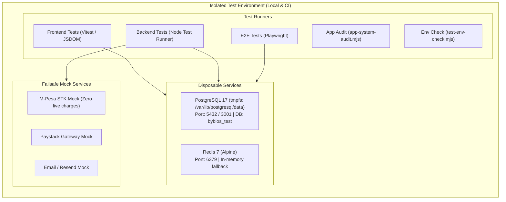

# Byblos Repeatable Test Environment

This document defines the repeatable, isolated test environment for Byblos, designed for local engineering, automated test execution, and CI/CD pipelines.

---

## 1. Architecture & Service Topology

The test environment provides disposable infrastructure, deterministic test accounts, and sample catalog fixtures without communicating with external payment gateways or production databases.



### Safety Boundaries

- **Database Name Guard:** `server/src/infrastructure/database/database.js` and `server/scripts/lib/testDbSafety.js` mandate that `NODE_ENV === 'test'` and `DB_NAME` ends with `_test`. Any connection attempt to hostnames containing `amazonaws.com` is aborted immediately.
- **Payment Gateway Isolation:** No real M-Pesa STK push or Paystack charges occur during testing. Test configurations default to mock endpoints and synthetic responses.
- **Disposable Volumes:** `docker-compose.test.yml` mounts PostgreSQL data on `tmpfs`, ensuring no state persists across restarts or resets.

---

## 2. Prerequisites

| Tool | Version Requirement | Purpose |
| :--- | :--- | :--- |
| **Node.js** | `>= 18.0.0` (Recommended: v20 or v22) | Application and test runtime |
| **npm** | `>= 9.0.0` | Package management and lifecycle scripts |
| **Docker & Docker Compose** | Docker Compose v2+ | Multi-container service provisioning (`postgres`, `redis`) |
| **Native Fallback** | Optional | If Docker daemon is stopped, tests run against local PostgreSQL (port 3001) with in-memory cache |

---

## 3. Test Lifecycle Commands

All environment lifecycle commands are exposed at the repository root:

```bash
# Verify environment readiness (Docker, Postgres, Redis, migrations, seed accounts)
npm run test:env:check

# Start disposable test services (Postgres + Redis)
npm run test:env:up

# Tear down disposable test services and wipe tmpfs data
npm run test:env:down

# Inspect status of running test services
npm run test:env:status

# Stream logs from test containers
npm run test:env:logs

# Create byblos_test database and apply schema migrations
npm run test:env:setup

# Reset database schema and re-seed test accounts/catalog
npm run test:env:reset

# Idempotently seed test accounts and sample catalog
npm run test:env:seed

# Complete rebuild: teardown, restart, migrate, and seed
npm run test:env:rebuild
```

---

## 4. Deterministic Seed Data

The test environment includes a deterministic, idempotent seed script (`server/scripts/seed-test-accounts.js`) that populates verified users, role assignments, profile records, and sample catalog items.

### Test Accounts

| Role | Email | Test Password | Notes / Relationships |
| :--- | :--- | :--- | :--- |
| **Admin** | `admin@byblos.test` | `ByblosTest#Admin1` | Operational & financial oversight |
| **Seller** | `seller@byblos.test` | `ByblosTest#Seller1` | Store: *Test Atelier*, referred by test creator |
| **Creator** | `creator@byblos.test` | `ByblosTest#Creator1` | Code: `TESTCREATOR`, linked to *Test Atelier* (10% commission) |
| **Buyer** | `buyer@byblos.test` | `ByblosTest#Buyer1` | Independent control buyer |
| **Logistics** | *Dynamic* | Bootstrapped from `MZIGO_EMAIL` | Mzigo delivery operations |

### Seeded Sample Products (*Test Atelier*)

| Product Name | Price (KSh) | Type | Inventory | Low Stock Alert |
| :--- | :--- | :--- | :--- | :--- |
| **Byblos Obsidian Oversized Hoodie** | KSh 4,500.00 | Physical | 50 units (tracked) | 5 units |
| **Handcrafted Brass Signet Ring** | KSh 2,200.00 | Physical | 20 units (tracked) | 3 units |
| **Digital Lookbook & Atelier Patterns** | KSh 1,000.00 | Digital | Unlimited (PDF download) | N/A |

---

## 5. Test Execution Suite

Once the test environment is verified (`npm run test:env:check`), run any of the test suites:

### 1. Application System Audit
Validates all routes, permissions, payment invariants, escrow rules, and database migration alignment:
```bash
npm run test:app
```

### 2. Frontend Unit & Integration Tests
Executes Vitest component and hook tests with JSDOM:
```bash
npm run test
npm run test:coverage
```

### 3. Backend Unit & Integration Tests
Executes backend Node test runner suites against `byblos_test`:
```bash
npm --prefix server run test
npm --prefix server run test:integration
```

### 4. End-to-End (E2E) Browser Tests
Executes Playwright browser smoke flows:
```bash
npm run test:e2e
```

### 5. Typecheck & Code Style
Ensures zero TypeScript and ESLint regressions:
```bash
npm run typecheck
npm run lint
npm --prefix server run lint
```

---

## 6. Continuous Integration (CI) Alignment

In GitHub Actions (`.github/workflows/test.yml`), tests run in an equivalent isolated environment:
- PostgreSQL 17 is provisioned as a container service with `byblos_test`.
- Redis 7 is provisioned as a container service.
- Migrations and deterministic seeds are applied prior to test execution.
- No production secrets or external APIs are accessed.
